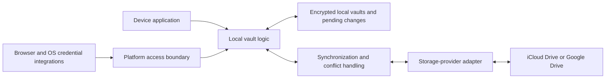

# PWDTWO — Technical Architecture

Status: Architecture decision resolution in progress. The user has finished adding constraints for now and explicitly requested that the open design questions be discussed before development. The 46 numbered entries capture confirmed requirements and proposals; the design is not yet ready for production vault implementation. Resolve the blocking decisions below before committing to the security and storage implementation. Exploration of a design without an application-operated backend remains the working direction, subject to the full accepted scope in [specifications.md](specifications.md). The user has removed trusted-contact emergency access and confirmed that deliberate sharing stays in scope. Owner recovery remains required, with no vendor or administrator recovery backdoor. The user approved the phased implementation baseline on 2026-10-09, recorded in [tasks.md](tasks.md#approved-development-phases). This approval does not close the outstanding architecture gates.

Entries distinguish constraints derived from accepted requirements, proposed technical approaches, and unresolved decisions. The user requires four separate native applications for macOS, iPadOS, iOS, and Android, with no HTML application views or container technologies. Swift with Apple's native UI frameworks and Kotlin with Jetpack Compose are the recommended language/framework choices below. Rust is confirmed for the shared native vault engine. Cryptographic libraries and the native vault format remain undecided.

Proposed component flow on each device:

Synchronization transfers encrypted vault data for cloud-enabled vaults; local-only vaults bypass the synchronization and provider components. Cloud-provider coverage follows entry 3. The browser and operating-system integrations vary by platform; this diagram does not select their APIs or process layout.

## Architecture requirements and working proposals

### iPhone application identity decision — 2026-10-14

The user approved `com.66ideas.pwdtwo.iphone` for the independent iPhone app, `com.66ideas.pwdtwo.iphone.autofill` for its password-provider extension, and `group.com.66ideas.pwdtwo` for their shared encrypted-copy container. Use these identifiers consistently in generated projects, signing entitlements, runtime container access and deployment verification. The previous `com.sixtysixideas.pwdtwo.iphone.development` identity was a temporary development choice. The user confirmed its existing vaults contain disposable test data and require no migration. The new identity requires its own authorized provisioning profiles; prior signing evidence does not authorize the new identity.

### 1. Explore operation without an application-operated backend

**Description:** User-selected direction for investigation. Installed applications should communicate directly with the user's chosen storage provider. Explore a design with no application-operated API, account database, synchronization server, or scheduled cloud function. Apple and Google remain external service providers. Do not introduce a hosted function or always-on owner device as an implicit substitute for a backend. Features needing independent online enforcement must have an explicit technical solution before this direction can be considered complete.

### 2. Persist and process vault data on the device

**Description:** Derived constraint. Each device needs a durable local copy of its available encrypted vaults and pending changes. Local access, updates, search, generation, and autofill must not depend on a network round trip. Proposed approach: perform vault operations locally and synchronize their encrypted results asynchronously. Successful local persistence and successful remote synchronization are distinct states. Search indexes, generator history, and other sensitive derived data must remain within the relevant vault's protection boundary. Confirmed generator-history policy, 2026-10-09: store generated passwords and passphrases inside the selected encrypted vault and retain them until the user explicitly clears generator history; no automatic expiration. Synchronize history and clear operations for cloud-enabled vaults. Define concurrent clear/generation handling without silently losing new offline records. Confirmed combined-search behavior: aggregate results from all currently unlocked vaults by default, preserve the source vault identity in each result, and support restricting the query to one vault. Locking a vault must remove its contents from searchable results; aggregation must not create an independently accessible plaintext cross-vault index. Confirmed combined browsing, 2026-10-09: provide an All unlocked vaults view for logins, cards, secure notes, and other supported item types, with source-vault labels and a filter for one vault. Require destination-vault selection when creating an item from the combined view. Invalidate the locked vault’s items and previews immediately in aggregate views; browsing must preserve the same per-vault access boundary as search. Interaction in combined browsing or search resets the shared application-wide inactivity timer under entry 6. User-confirmed search field scope, 2026-10-09: ordinary text search covers titles, usernames, website addresses, tags, and notes; exclude password values, authenticator secrets, and other hidden secret fields from both ordinary matching and its derived indexes. Apply field-type exclusions consistently across native applications. Notes remain searchable as explicitly agreed; this is not a promise to detect and redact secrets manually written inside note text. Confirmed note representation: store entry notes and standalone secure notes as plain multiline text, preserving paragraph breaks. Render clickable web links with native platform controls; no rich-text storage or HTML view is required. Opening a link is a deliberate user action, not automatic fetching or preview generation.

### 3. Use separate storage-provider adapters

**Description:** Derived coverage with a proposed component boundary. An iCloud Drive adapter serves macOS, iPhone, and iPad; a Google Drive adapter serves macOS, iPhone, iPad, and Android. Each vault uses either local-only storage with no cloud-provider binding, or exactly one active cloud-provider binding, chosen independently of other vaults. Provider authorization grants file access and remains separate from vault decryption. The adapters transfer encrypted data and report provider versions, errors, and pending work to the vault synchronization component. Confirmed on 2026-10-09: permit encrypted revision transfers while the vault is locked, subject to provider authorization and available platform execution. Decryption, authenticated content validation, and merging that require unavailable vault keys wait for unlock. Stage incoming revisions and preserve pending local changes plus the last validated usable revision; downloading opaque bytes does not establish that they are valid or safe to overwrite local state with. Outgoing transfers must obey the provider concurrency protocol and must not blindly overwrite unseen remote changes. Report transferred-but-unmerged revisions as pending rather than claiming reconciliation is complete. A vault must not synchronize simultaneously through iCloud Drive and Google Drive; see entry 23. Google documents direct authorization for installed applications; registration, appropriate scopes, and applicable verification are still necessary even without our own backend. [Google installed-app authorization](https://developers.google.com/identity/protocols/oauth2/native-app).

### 4. Isolate vault keys and recovery paths

**Description:** Independent vault passwords and alternative recovery keys are derived constraints; the user has replaced independent inactivity locking with a shared application-wide session under entry 6. Proposed security boundary: encryption and decryption occur on the device; neither storage providers nor application services receive plaintext vault contents or the secrets needed to decrypt them. Biometric access protects device-local unlocking material through platform security facilities. Confirmed biometric fallback, 2026-10-09: require the vault password when biometrics are unavailable, disabled, or unsuccessful; do not authorize vault unlocking through a device PIN, screen-lock passcode, or operating-system login credential. Forgotten-password access follows the separate recovery-key process. Apply this rule to the application and autofill integrations. Validate the platform authentication and key-access policies so system device-credential fallback cannot release vault-unlocking material; exact API and key-storage configurations remain engineering work. Confirmed on 2026-10-09: provide an optional periodic vault-password re-entry policy, disabled by default, with a user-selected interval when enabled. When the interval has elapsed, biometric unlocking alone must not reopen that vault; successful vault-password authentication is required. Enforce the policy consistently in application and autofill access paths. This optional policy is separate from mandatory new-password entry after learning of a password change or recovery. This policy is configured locally on each device. Supported interval choices and robust elapsed-time enforcement remain implementation details; the disabled initial setting is confirmed. The detailed key hierarchy, password derivation, recovery material, rotation protocol, and handling of offline devices remain to be designed alongside the file format. Confirmed normal-change authentication, 2026-10-09: require successful entry of the current vault password before an ordinary password change, even in an already unlocked or biometrically unlocked session. An unlocked session or biometric authentication alone does not authorize that operation. If the current password is forgotten, use the recovery-key flow. Enforce this requirement at the vault-operation boundary, not solely in the user interface. Confirmed lifecycle policy: ordinary password changes preserve the recovery key; forgotten-password recovery replaces both password and recovery key and requires confirmation that the replacement recovery key was saved. The new vault generation must not accept the replaced recovery key. Older backups and offline copies keep their original protection until explicitly rewritten; rotation must not be presented as retroactive erasure or remote revocation. The recovery path must work without the forgotten vault password and must not require an online service when the necessary files and recovery information are available locally. Recovery is controlled by the owner: no vendor, administrator, or trusted contact receives escrowed secrets or an alternative reset capability. If the password and recovery key are lost and no existing authorized unlock path remains usable, access cannot be restored. Enabled biometric unlocking remains an authorized device-local path, not a separate third-party recovery service.

### 5. Preserve concurrent changes durably

**Description:** Derived conflict and offline requirements, with a proposed synchronization boundary. Vault logic, rather than the provider's generic file synchronization, determines how entries merge. Preserve the local state and incoming remote versions before reconciliation, including interrupted transfers and changes arriving while a vault is locked. Track unresolved entry conflicts separately from ordinary history retention. User-confirmed entry-history policy, 2026-10-09: retain previous entry versions in the encrypted vault indefinitely until the user explicitly clears that entry’s history, with no automatic expiration. Synchronize history and explicit history-clear operations for cloud-enabled vaults, while preserving unresolved conflicts independently. Confirmed history coverage, 2026-10-09: preserve all editable item fields and the attachment content referenced by each historical version, including files subsequently replaced or removed. Restoration must reconstruct the complete retained version. Retained attachment versions contribute to vault size until the user explicitly clears the relevant history. Any attachment reclamation must account for references from current entries, other retained history, trash, and unresolved conflicts; clearing one history must not remove content still needed elsewhere. Validate reference handling and full-version round trips for each supported record type. User-confirmed trash policy, 2026-10-09: retain deleted entries in the encrypted vault indefinitely until the user explicitly empties the trash; no time-based or scheduled purge. Synchronize the explicit empty-trash operation for cloud-enabled vaults. Confirmed restoration policy, 2026-10-09: when a matching active entry exists, restore the trashed entry as a separate item, preserve the existing entry unchanged, and flag the possible duplicate for review. Do not automatically overwrite or merge the active entry. Define duplicate matching and restoration identity handling so reconciliation preserves both records, including when an active record already uses the restored record’s original identity. Reconciliation must preserve the accepted handling of conflicting offline edits and distinguish deletion-tracking metadata from recoverable trash contents. Local saves need crash-safe replacement; remote updates need a validated concurrency strategy for each provider. Merely checking a remote timestamp before an unconditional upload is not sufficient. The exact version metadata and storage protocol remain open. Confirmed cross-vault transfer behavior, 2026-10-09: both vaults must be unlocked; copies are independent destination entries containing supported data, notes, attachments, and history. A move durably saves the complete destination entry before moving the original to source-vault trash. Failure to save the destination must leave the source intact. Encrypt each persisted copy under its destination vault’s protection. Design interrupted-operation recovery and retry identification to avoid source loss or duplicate destination entries; separate vault files and provider updates are not assumed to form one atomic transaction.

### 6. Separate vault logic from platform integrations

**Description:** User-confirmed shared-core direction. Keep record handling, vault access policy, import/export, and conflict resolution behind interfaces independent of application screens. All four applications use one shared compiled native library for vault file handling, cryptographic operations, recovery, and synchronization/conflict rules. Platform adapters provide secure storage, biometrics, lifecycle/lock events, file-provider access, browser communication, and operating-system credential integration. Browser and autofill components must enforce the same per-vault access boundaries and limit the credentials exposed to the requesting surface. Confirmed inactivity policy, 2026-10-09: only user interaction with PWDTWO or deliberate use of its autofill resets the automatic-lock timer. General browsing, input in other applications, and synchronization or other background work must not extend an unlocked session. Device locking independently locks all open vaults immediately. The user confirmed a five-minute default inactivity timeout, adjustable in Settings separately on each device. Store the timeout preference locally rather than synchronizing it; changing it on one device must not change another device’s timeout. Platform adapters must distinguish deliberate user activity from background integration events. Revised by the user, 2026-10-09: use one application-wide inactivity timer for all open vaults on the device. Deliberate interaction with any vault, combined browsing/search, or autofill resets that shared timer and keeps all currently unlocked vaults open. Manual application locking, inactivity expiration, and device locking lock all open vaults together. This replaces independent per-vault inactivity timers and selected-vault manual locking. Keep vault encryption credentials separate; the common session is not a common vault password. Confirmed shared reopening, 2026-10-09: restore the previously open vaults as one session, using one biometric authentication for included vaults with enabled biometric access that are eligible for it. Collect any required vault passwords before completing the session unlock. Let the user remove a vault from this opening session and continue with the remaining vaults; do not expose included vault contents until all remaining included vaults meet their authentication requirements. Preserve mandatory password re-entry after credential changes and optional periodic re-entry. There is no additional application-wide password. Validate platform support for one biometric interaction securely authorizing multiple separately protected vaults, including cancellation, unavailable vaults, device-lock events during authentication, and extension entry points; the 2026-10-09 Mac prototype passes an injected-authentication session model, but actual single-interaction biometric authorization of multiple protected vaults remains unproven. See the macOS feasibility evaluation below. Supported timeout choices and session coordination across application and extension processes remain engineering details. Four separate native application targets are required by entry 13. Rust is selected for the shared library; bindings, detailed API boundaries, inter-process communication, and entitlements remain technical decisions. Operating-system support follows entry 18.

### 7. Treat KDBX as a conditional format choice

**Description:** Derived preference. Assess current KDBX implementations before choosing the native storage format. PWDTWO is the primary application; the user explicitly does not require full compatibility or interchangeable editing with other KeePass applications. PWDTWO-specific extensions are acceptable within the conditional KDBX direction. Validate all supported records and recovery paths across PWDTWO clients, and define a narrower, tested compatibility scope for external readers or exports. Standard KeePass combines configured password/key-file components rather than treating them as alternative recovery secrets, and its shared databases have no per-entry access controls. Architectural inference: owner recovery and secure delivery of individual snapshots need additional mechanisms if KDBX is adopted. Shared vaults do not require an internal role system; participants have equal access to their contents. Any companion metadata must have explicit portability, backup, atomicity, and external-client compatibility rules. A documented PWDTWO-specific native format with KDBX import/export remains an alternative to evaluate, not an approved replacement. Such a format would remain open source but would not automatically interoperate with other KeePass clients. [KeePass master keys](https://keepass.info/help/base/keys.html), [KeePass multi-user behavior](https://keepass.info/help/base/multiuser.html).

### 8. Make backups independent of synchronization history

**Description:** Derived constraint. A recoverable encrypted backup must include the vault data and all format-specific information needed by its supported unlock and recovery paths. Provider revision retention must not be the sole backup mechanism. Proposed approach: version backup structures and validate restorability before replacing live data. Recovery metadata, conflict records, attachments, and migration behavior must be accounted for when the format is chosen. Existing backups retain the credentials valid when created; later password changes or recovery do not rewrite them. Updated behavior, 2026-10-09: scheduled encrypted backups are opt-in and disabled by default; the user controls their frequency in application Settings and can change or disable the schedule. Do not impose daily backups or mandatory pre-operation backup triggers. Corrected by the user on 2026-10-09: each vault has one backup configuration and exactly one application-managed backup; both synchronize across participating devices for cloud-enabled vaults. Each successful backup replaces the previous one; there is no application-managed backup history or configurable version count. The user selects one device responsible for creating scheduled backups; this may be a Mac or another supported device. Other devices synchronize the settings and encrypted backups rather than running independent backup schedules. If the designated device is offline when a backup is due, it performs the overdue backup when it comes back online. Manual encrypted exports to a user-selected location remain available. Include entries, attachments, history, trash, and required recovery metadata without embedding an unprotected recovery secret. Restore as a separate vault by default; replacing a live vault requires an explicit choice. A restored copy must not inherit an active binding that can overwrite the original cloud file. Confirmed selective recovery, 2026-10-09: open the backup as a separate vault and copy user-selected entries into the current vault through the established cross-vault copy operation. Require both vaults to be unlocked, assign independent destination records, preserve supported content including notes, attachments, and history, and leave existing destination entries unchanged. Do not add automatic whole-backup merging. Explicit full-vault replacement remains a separate reviewed operation. Confirmed backup location, 2026-10-09: store the scheduled backup as a separate encrypted file alongside a synchronized live vault in that vault’s selected cloud provider. Use distinct file identities for the live vault and backup so replacing the backup cannot overwrite live data. For local-only vaults, store the scheduled backup in a user-selected local folder without synchronization. Manual exports may use other user-selected destinations. Confirmed backup-device handover, 2026-10-09: allow replacement when the former designated device is lost or unavailable, without its approval. The replacement takes over after connecting and synchronizing the assignment; preserve the existing backup and chosen frequency. The former device must verify the current assignment before writing again and must stop if reassigned. The provider concurrency protocol must guard against stale assignments and in-flight writes across a handover; a check followed by an unconditional upload is insufficient. Exact assignment versioning, conditional publication or equivalent coordination, supported frequency choices, platform scheduling and folder-access limits, and packaging remain engineering work. Attachments are embedded in the complete vault file under entry 29.

### 9. Evaluate provider-based sharing of separate encrypted containers

**Description:** Both sender and recipient must have compatible PWDTWO applications, as confirmed by the user on 2026-10-08. No browser-only secret reader is required. Individually shared entries are independent snapshots; ongoing synchronization is limited to shared vaults. A received snapshot has its own record identity and no update or deletion relationship with the source entry. Define version negotiation and reject unsupported sharing formats without exposing content. Proposed approach under investigation: use provider sharing permissions for access to encrypted files, with a separate key-distribution mechanism. Sharing a subset of entries must not disclose the key to the owner's entire private vault; separate shared containers are a candidate boundary. Google Drive is the cross-platform candidate, while iCloud Drive sharing serves Apple devices. Shared-vault participants have equal access to all vault contents using shared unlocking credentials; there are no PWDTWO owner/editor/viewer roles, per-entry access controls, or export restrictions. User-confirmed recovery policy, 2026-10-09: every participant receives that shared vault’s password and recovery key and can recover it. Apply the established password/recovery-key replacement lifecycle on recovery and design secure distribution of replacement credentials to participants. This is explicit access to the shared vault, not recovery authority over another participant’s private vaults. Cloud file permissions govern remote file access and management, not decryption or retained copies. Configure collaborative participants with provider write access, while respecting provider-specific ownership, sharing, and file-deletion rules. Secure delivery and redistribution of shared passwords/recovery keys, implementation of concurrent credential-change resolution, and format compatibility remain unresolved; the user-facing conflict policy follows D03. Apple documents invited-user sharing and read/change permissions for iCloud Drive files; Google documents reader/writer file roles. [Apple file sharing](https://support.apple.com/guide/iphone/share-files-and-folders-in-icloud-drive-iph17f9f92a6/ios), [Google Drive roles](https://developers.google.com/workspace/drive/api/guides/ref-roles).

### 10. Transfer encrypted individual copies without expiring links

**Description:** User-confirmed replacement of the earlier expiring-link feature. An individual share is an encrypted snapshot that the recipient imports into PWDTWO. Confirmed payload scope, 2026-10-09: include current fields only, exclude previous passwords and entry history, and let the sender choose whether notes and attachments are included in the preview. Construct a transfer record from the selected current content rather than serializing the entire source entry object with its history. This restriction applies to individual shares, not equal-access shared vaults or the separately approved history-preserving copies/moves between the user’s unlocked vaults. Both parties need compatible application versions. There is no application-enforced collection deadline, expiry, or remote revocation of the transferred copy. No online link-expiry service or browser secret reader is required. Confirmed unlocking flow: generate a strong random transfer password independent of all vault credentials, encrypt the copy, and have the sender communicate that password separately from the file. The recipient imports in PWDTWO using that password. It is a reusable bearer secret with no expiry, not a single-use code or a named-recipient identity guarantee. Design the transfer format and authenticated encryption using maintained libraries without disclosing the source vault's unlocking secrets. Never automatically include the transfer password alongside the encrypted file. Transport choices remain open; the accepted behavior does not select email, messaging, a provider link, or a hosted service. Shared vaults continue to provide ongoing synchronization separately.

### 11. Exclude trusted-contact emergency access

**Description:** User-confirmed scope revision on 2026-10-08. Remove automatic or timed emergency access for another person, including contact nomination, waiting periods, denial notifications, and delayed key release. No release service is needed for that removed feature. Retain owner-controlled recovery under entry 4 and deliberate sharing under entries 9–10. This entry retains its number for traceability to withdrawn functional story 37.

### 12. Use provider authorization and local vault unlocking for device setup

**Description:** User-confirmed flow. A new installation opens a vault from its selected provider or a local file, completes any required provider authorization, and unlocks with the vault password or recovery flow. Biometric unlocking can then be enabled locally. Do not create a separate PWDTWO account, application-managed MFA/enrollment service, existing-device approval flow, or remote device-revocation mechanism. Apple/Google account security and applicable OS device controls remain external responsibilities. Provider authorization and vault decryption are separate boundaries; possession of a local vault copy and valid unlocking material permits offline access. Informational device-activity records must not be treated as an authoritative access list. Do not claim remote disabling or erasure of downloaded vaults or retained secrets.

### 13. Build four separate native applications

**Description:** User-confirmed technical requirement. Develop distinct application products and build targets for macOS, iPadOS, iOS (iPhone), and Android. Each has a platform-specific native interface and lifecycle integration. Application screens must not use HTML views, embedded browser renderers, Electron, Cordova, or comparable application containers. The macOS application must target the macOS SDK directly, with neither Mac Catalyst nor an iPhone/iPad application running on the Mac as its implementation. Mobile application distribution must not substitute for the dedicated Mac product. iPhone and iPad have their own application targets; an iPhone compatibility interface is not the iPad product. Repository layout, bundle identifiers, store listings, and release coordination will be specified separately.

### 14. Recommend Swift for each Apple application

**Description:** Technical recommendation. Use Swift for the macOS, iPadOS, and iOS applications, with separate native UI implementations compiled for their respective targets. Use SwiftUI as the default UI framework. In the macOS target, integrate AppKit where Mac-specific behavior or APIs require it. In the iPadOS and iOS targets, integrate UIKit where needed. These are Apple's native application frameworks; using SwiftUI on macOS does not require running an iPad application on the Mac. Use Xcode and the appropriate Apple SDKs for builds, signing, and platform extensions. Deployment targets follow entry 18; exact toolchain versions remain open. This recommendation follows Apple's guidance for new applications and SwiftUI interoperability with AppKit/UIKit. [Apple app technologies](https://developer.apple.com/documentation/technologyoverviews/app-design-and-ui?language=objc), [SwiftUI](https://developer.apple.com/documentation/technologyoverviews/swiftui?language=objc).

| Application target | Language | Recommended native UI stack |
| --- | --- | --- |
| macOS | Swift | SwiftUI with AppKit integration where needed; direct macOS target for Apple silicon |
| iPadOS | Swift | SwiftUI with UIKit integration where needed; dedicated iPad target |
| iOS / iPhone | Swift | SwiftUI with UIKit integration where needed; dedicated iPhone target |

### 15. Recommend Kotlin for the Android application

**Description:** Technical recommendation. Use Kotlin with Jetpack Compose for the dedicated Android application's native interface and Android SDK integrations for platform capabilities. Use Android Studio and Gradle for development and builds. This follows Google's Kotlin and Compose direction and provides direct access to Android credential, biometric, storage, and lifecycle APIs. Do not use a web container or a shared cross-platform UI runtime for this application. Android version support follows entry 18; exact toolchain versions remain open. [Kotlin for Android](https://developer.android.com/kotlin), [Android Compose guidance](https://developer.android.com/develop/ui/compose/first).

### 16. Share one native vault library across four separate applications

**Description:** User-confirmed implementation organization. Use one compiled non-UI library across macOS, iPadOS, iOS, and Android for reading/writing vaults, encryption through maintained cryptographic libraries, recovery, and synchronization/conflict rules. Each application retains its own native interface and platform integration: Swift with Apple frameworks and Kotlin with Android frameworks. Platform adapters handle storage-provider access, secure device storage, biometrics, lifecycle, and autofill. Shared Swift packages may additionally support Apple-specific integration without duplicating the common vault engine. Verify cross-platform semantics with common compatibility fixtures and security-relevant tests. A shared library does not combine the application products or introduce a shared UI runtime. Rust is the user-approved shared-core language. Dependencies, bindings, and exact module boundaries remain subject to feasibility, security, and licensing assessment. UniFFI is the proposed Swift/Kotlin binding generator, pending integration validation.

### 17. Keep browser automation separate from native application views

**Description:** Technical integration boundary. Browser autofill needs browser-side code to inspect and fill website fields. Chrome extension scripts execute JavaScript; TypeScript compiled to JavaScript is the proposed authoring language for that browser-specific code, with a native host for access to the macOS application. Safari also exposes script/native integration options; the exact extension approach remains to be chosen. This browser automation does not authorize HTML application screens or a web-rendered vault interface. Plan for native credential-selection surfaces and native application windows; do not assume a Chrome HTML popup can render native controls. External provider authorization may open the provider's system-browser flow rather than embedding an HTML screen in our applications. Mobile integration API choices remain separate from the macOS extension design. User-confirmed behavior, 2026-10-09: login-form auto-submit is off by default and configurable in Settings. Enabling it allows submission of supported login forms after deliberate autofill, subject to the existing unlock, account-selection, and host-matching rules. It does not authorize filling on page load without user action or submission of unrelated payment/account-change forms. Validate submission capability separately for each supported browser/platform integration and retain manual submission when unavailable. The preference remains local to each device; reliable identification of login submission controls remain engineering details. [Chrome native messaging](https://developer.chrome.com/docs/extensions/develop/concepts/native-messaging), [Safari app extensions](https://developer.apple.com/documentation/safariservices/safari-app-extensions?changes=l_5), [Safari web extensions](https://developer.apple.com/documentation/safariservices/safari-web-extensions?changes=_5).

### 18. Support the current and previous major OS generations

**Description:** User-confirmed support policy. Each native application supports the current stable major operating-system generation and the immediately preceding major generation. The user explicitly selected Apple OS generations 26 and 27. The corresponding Android baseline is Android 16 and 17, verified against Google's release announcement and API-level documentation on 2026-10-08.

| Native application | Initial supported major versions | Initial minimum deployment version |
| --- | --- | --- |
| macOS / Apple silicon | macOS 26 and 27 | macOS 26 |
| iPadOS | iPadOS 26 and 27 | iPadOS 26 |
| iOS / iPhone | iOS 26 and 27 | iOS 26 |
| Android | Android 16 and 17 | Android 16 / API level 36 |

This is a rolling two-generation support window. Stable minor updates, security updates, and Android quarterly releases remain within their major generation; preview/beta releases do not advance the production support window. Update the supported and tested matrix as new stable major generations are released. The transition schedule for raising future application deployment targets remains to be specified. Ending maintenance for an older generation does not imply remotely disabling existing installations or denying access to locally stored vaults.

**Confirmed browser support, 2026-10-09:** Support Safari versions supplied with the supported macOS, iOS, and iPadOS releases. On Mac and Android, support the latest stable Chrome major version and the immediately preceding major version. Browser beta and developer releases are outside the guaranteed support range. Maintain this as a rolling test matrix; browser-version eligibility does not by itself validate passkey, payment, identity, or extension capabilities, which still require platform-specific verification.

**Implementation implications:** Test each application on both supported generations, including its platform integrations. Guard newer APIs and provide compatible implementations where required so that accepted functionality remains available on the older supported generation. For Android, the initial minimum is `minSdk = 36`; Android 17 is API level 37. Minimum installation eligibility is separate from `targetSdk` and `compileSdk`. The proposed initial build targets API 37, subject to validation against the distribution requirements at implementation time. Do not impose an upper OS version cap to express this support policy. Apple application and extension deployment targets must be compatible with the corresponding version-26 baseline.

[Android 17 release announcement](https://android-developers.googleblog.com/2026/06/Android-17.html), [Android versions and API levels](https://developer.android.com/guide/topics/manifest/uses-sdk-element).

### 19. Support Apple silicon exclusively on macOS

**Description:** User-confirmed technical requirement. The macOS application supports Apple silicon Macs only, within the operating-system support window in entry 18. Build the application and its native helpers, extensions, and dependencies for ARM64. Intel Mac support and x86_64 distribution binaries are out of scope; the application must run natively without a Rosetta dependency. Validate Mac releases on Apple silicon hardware.

### 20. Distribute the notarized Mac application through GitHub and 66ideas.com

**Description:** User-confirmed distribution requirement. Distribute the Apple-silicon macOS application as a direct download hosted on GitHub Releases for 66IDEAS/PWDTWO, with the same download file linked from 66ideas.com, following the user’s MD22 distribution model. The release process must sign the application and its bundled executable components with the appropriate Developer ID identities, enable the Hardened Runtime with the required entitlements, include secure timestamps, and obtain successful Apple notarization before publication. Staple and validate the notarization ticket on the supported release artifact, and verify the downloaded artifact's signature and Gatekeeper assessment. These release requirements follow [Apple's notarization guidance](https://developer.apple.com/documentation/security/notarizing-macos-software-before-distribution?changes=_5).

The website domain is confirmed as 66ideas.com and the download host as GitHub. Implementation choice, 2026-10-20: use a signed/notarized/stapled `PWDTWO-X.Y.Z-arm64.dmg` for manual download, a stapled-app `PWDTWO-X.Y.Z-arm64.zip` for Sparkle, and signed `appcast.xml` plus `SHA256SUMS` and a release manifest as assets of GitHub tag `vX.Y.Z`. The feed is `https://github.com/66IDEAS/PWDTWO/releases/latest/download/appcast.xml`. The PWDTWO product/download card on `https://66ideas.com/` will link directly to the immutable version DMG URL under `/66IDEAS/PWDTWO/releases/download/vX.Y.Z/`; the manifest supplies this exact target. Local CLI tooling prepares artifacts without public publication. As of 2026-10-20, the full 0.5.1 candidate has authorized Developer ID distribution profiles and successful Apple notarization for its app and DMG. The signed ZIP/appcast and final checksum/manifest set also pass verification. Public feed/download/website publication and browser distribution acceptance remain separate gates; the installed development app is unchanged. The built-in updater uses Sparkle as specified in entry 24. Static website hosting and release-time notarization do not introduce an application-operated runtime backend. Keep signing identities and notarization credentials outside the public source repository. Mobile distribution follows entry 22; browser-extension distribution remains a separate decision.

### 21. Publish the application source under the MIT licence

**Description:** User-confirmed project requirement. Make the project's original application and integration source code open source under the MIT licence, with SPDX identifier `MIT`. Maintain a root `LICENSE` file containing the standard MIT text and the confirmed copyright-holder notice. Include the licence notice in source distributions and the applicable notices in binary releases. The copyright holder is 66IDEAS, as confirmed by the user; the root licence notice is Copyright (c) 2026 66IDEAS. User-confirmed source host, 2026-10-09: a public GitHub repository under 66IDEAS named PWDTWO (66IDEAS/PWDTWO). Use its GitHub Issues for bug reports, including diagnostic reports deliberately attached after user review. Publication status, 2026-10-20: the public 66IDEAS/PWDTWO repository now exists and is connected to the local checkout; only specs/ is published by explicit user request. Application source, build files, guides and binaries remain local. No application release or update feed has been published. Application-code and release-asset publication remain separate work; repository creation and specifications-only publication are complete.

Assess dependency licences when selecting vault-format libraries, cryptographic libraries, and other bundled components. Third-party code retains its own licence and notices; selecting the MIT licence for this project does not relicense dependencies. Library choices must permit the intended source and binary distribution. Provide build instructions and configuration templates so contributors can build the source with their own development credentials. Official release signing credentials and user vault data are not public project assets. See the [standard MIT licence](https://opensource.org/license/mit) and [project constitution](constitution.md).

### 22. Distribute mobile applications through the platform stores

**Description:** User-confirmed distribution requirement. Distribute the separate native iPhone and iPad applications through Apple's App Store, and the native Android application through Google Play. Maintain the distinct application products and build targets specified in entry 13. Prepare platform-specific signed release artifacts and store release workflows, with signing credentials kept outside the public source repository. Application identifiers, publisher-account configuration, and release automation remain implementation details to specify. This decision selects distribution channels; it does not publish any application or change the direct-download macOS distribution requirement.

### 23. Bind each synchronized vault to one cloud provider

**Description:** User-confirmed technical requirement. Each synchronized vault uses exactly one cloud provider at a time: iCloud Drive or Google Drive. Different vaults may use different providers. All devices synchronizing a given vault use that vault's configured provider and remote file identity. The application must not maintain simultaneous replicas of the same vault across both providers or bridge changes between them. Local offline copies remain part of the selected provider's synchronization flow. Independent backups and exports remain separate from active synchronization. Storage migration is required by entry 27 and must preserve the single-active-provider constraint.

### 24. Use Sparkle for built-in macOS updates, following MD22

**Description:** User-confirmed technology selection. PWDTWO's directly distributed macOS application will use Sparkle, the updater used by [66IDEAS/MD22](https://github.com/66IDEAS/MD22). Inspection of MD22 revision `5f4ff2c9328320a514bb8899ff49926320327a8b` on 2026-10-08 confirmed Sparkle **2.9.4**, integrated through Swift Package Manager, with an `UpdateService` owning an `SPUStandardUpdaterController`. Reuse this integration approach; select and pin an appropriate maintained Sparkle release during implementation rather than assuming MD22's inspected version must remain fixed indefinitely.

The implementation will have a PWDTWO-specific HTTPS appcast and update-signing key pair. Use signed update archives and signed feeds, verify archives before extraction, and retain Developer ID signing and notarization for Mac releases. Keep the private update-signing key outside source control and public hosting. The source reference does not select MD22's feed URL, keys, repository, or release destination for PWDTWO. Static hosting for the appcast and release artifacts fits the proposed architecture without an application-operated runtime backend. GitHub Releases is the selected Mac download host; the pinned appcast and exact asset/feed URLs are recorded in entry 20 and dev/macos-release/sparkle.json; they have not been published.

PWDTWO's user-confirmed update policy is to check automatically and require explicit user approval before installing each update. Manual update checks remain available. Configure Sparkle to disable automatic installation and its automatic-install opt-in (`SUAutomaticallyUpdate = NO`, `SUAllowsAutomaticUpdates = NO`). Declining or postponing an update leaves the current application usable; update installation must not silently terminate or relaunch it. Integrate approved update/relaunch handling with durable vault saves and data-migration safeguards. User-confirmed checking policy, 2026-10-09: use a 24-hour automatic-check interval, matching the inspected MD22 configuration, and provide a Settings option to disable automatic checks. Keep manual Check for updates available regardless of that preference. The schedule depends on connectivity and application execution; do not introduce an always-running service merely to meet the interval. Mobile applications continue to use their platform stores for application updates.

Preserve PWDTWO's native-view requirement when configuring Sparkle. Disable its embedded release-notes display (`SUShowReleaseNotes = NO`); any in-app release summary must use native controls. Verify the final updater UI and integration against this requirement. MD22's renderer and unrelated sandbox choices are not part of the updater selection.

**Implementation, 2026-10-20:** pin Sparkle 2.10.0 by official artifact SHA-256, using its native standard controller and a PWDTWO-specific Ed25519 key. The existing CLI Swift builder consumes the verified official framework directly, with arm64 thinning and inside-out signing; it does not adopt MD22's separate SPM application build. Disable signed-feed expiry fallback as well as profiling, HTML notes and automatic-install opt-in. The development channel keeps network checks disabled while unpublished; the release channel retains the approved daily/default/manual policy. Deferral uses Sparkle's actual postponement callback, with the application's existing save/edit termination guard retained. See the release-preparation README for commands, validation receipts and unresolved profile/publication gates.

**Verified reference files:** [Updater service](https://github.com/66IDEAS/MD22/blob/5f4ff2c9328320a514bb8899ff49926320327a8b/implementations/mac/MD22/Services/UpdateService.swift), [package pin](https://github.com/66IDEAS/MD22/blob/5f4ff2c9328320a514bb8899ff49926320327a8b/implementations/mac/Package.resolved), [updater settings](https://github.com/66IDEAS/MD22/blob/5f4ff2c9328320a514bb8899ff49926320327a8b/implementations/mac/MD22/Info.plist), [feed generation](https://github.com/66IDEAS/MD22/blob/5f4ff2c9328320a514bb8899ff49926320327a8b/implementations/mac/scripts/generate-appcast.zsh). Framework guidance: [Sparkle setup and signing](https://sparkle-project.org/documentation/), [configuration options](https://sparkle-project.org/documentation/customization/).

### 25. Use PWDTWO as the application name

**Description:** User-confirmed product identity. The application name is **PWDTWO**, with this capitalization, across the separate native applications, documentation, release artifacts, and store metadata. The MIT copyright holder remains **66IDEAS**. The separately confirmed public repository location is GitHub 66IDEAS/PWDTWO. The website domain is 66ideas.com, linking to the GitHub-hosted Mac download. Platform bundle identifiers, signing identities, and exact website/release URLs remain to be chosen.

### 26. Support local-only vault storage

**Description:** User-confirmed technical requirement. All four native applications support vaults stored locally without an iCloud Drive or Google Drive connection. Model the vault storage mode explicitly as local-only or synchronized through one provider. A local-only vault has no active provider binding, remote file identity, or pending synchronization operations. Its creation, local unlocking, recovery using locally available material, and local persistence must not require cloud-provider authorization.

Use the same encrypted vault format, per-vault protection, and local vault logic for both storage modes. Local-only vaults must remain available to authorized native application and autofill integrations. Persist their changes durably without generating upload work when connectivity returns. Store application-managed local-only files outside cloud-provider-managed synchronization locations. Exports and independent backups remain explicit, separate operations. Migration between storage modes follows entry 27. User-confirmed policy, 2026-10-09: exclude local-only vaults from automatic operating-system cloud backups. Transferring such a vault to cloud storage requires an explicit user-selected backup/export or storage-mode migration. Apply and verify each platform’s app-data backup exclusion mechanisms, including derived sensitive files; assess whether a platform exclusion also affects local device backups. Do not silently rely on a local file path alone to establish cloud exclusion. Platform validation remains necessary before claiming the guarantee. Explicit user-selected backup/export operations remain available.

### 27. Migrate vaults between local and cloud storage

**Description:** User-confirmed technical requirement. Support migration in both directions between local-only storage and a supported cloud provider, and between iCloud Drive and Google Drive. A migration involving iCloud Drive must run on a supported Apple platform. Preserve the logical vault identity, supported contents, history, attachments, unresolved changes, and required recovery information. Changing storage location does not by itself change the vault password or recovery key.

**Proposed implementation approach:** Persist a recoverable migration state, preserve the source, stage and verify a complete encrypted destination copy, and then commit the new storage binding. Temporary transfer copies are not additional active synchronization providers. Suspend the migrating device's normal source synchronization while completing the transfer; failed or interrupted transfers must remain resumable or recoverable without discarding source data. Cloud-to-local migration must make required content available locally before completion, and local-only mode must stop cloud synchronization. After verifying the destination and committing the new storage binding, delete the old cloud copy automatically, as required by the user. Do not retain it as an application-managed backup. Before deletion, confirm that the source identity and revision still match the migrated data; preserve and reconcile any newer source edits instead of deleting them. Persist cleanup status so that interrupted or failed deletion can be retried. Report cleanup as pending until provider deletion succeeds, while retaining the verified destination and avoiding reactivation of the old provider. Provider-side deletion must not be described as erasing offline copies or independent backups.

Define a coordination protocol for other devices, including offline devices, concurrent migrations, and unsynchronized edits. A completed migration on one device must not be presented as instant reconfiguration or erasure of every other device. Devices that still reference the old location must preserve their pending changes and require safe reconciliation/rebinding before joining the migrated vault. Destination provider authorization is required on each device where applicable. The old cloud copy is deleted after successful migration. Migration notification and the exact handling of devices returning after migration remain detailed decisions; stale clients must not silently recreate a deleted source vault.

### 28. Keep diagnostics on-device with deliberate support exports

**Description:** User-confirmed technical requirement. PWDTWO's application-managed diagnostics remain on the device. Do not add remote analytics, telemetry, or automatic crash-report uploads. Users can deliberately generate and share a diagnostic report with the maintainer, 66IDEAS, for a bug report. Diagnostic collection, report generation, and viewing must work without a reporting backend; transmission occurs only through a user-initiated export/share action.

**Proposed implementation approach:** Use bounded local diagnostic storage and a structured allowlist of technical fields, such as app/build version, OS version, component/error codes, and sanitized operation outcomes. Exclude vault contents, entry and vault names, credentials, recovery keys, cryptographic keys, provider tokens, website/login data, personal file paths, and raw provider responses. Do not record these values in the first place; sanitize exception and platform diagnostic inputs before storage. Build support reports from the approved fields rather than attaching raw logs, memory dumps, screenshots, or vault files. Apply an additional export validation pass and test redaction with representative secret-bearing errors.

Provide a native preview of the generated report, allow users to omit optional diagnostic sections, and let them save or share it deliberately. A report must not be uploaded automatically or silently posted to a public issue tracker. Keep logs outside synchronized vault contents. User-confirmed retention, 2026-10-09: retain sanitized diagnostic logs for up to seven days, cap log storage at 10 MB per device, and automatically remove the oldest logs to enforce these limits. Provide immediate manual clearing in Settings. Apply these limits to application-managed diagnostic logs; do not automatically delete reports the user has exported to their own files. Configure third-party components consistently, including disabling Sparkle system profiling. This requirement governs PWDTWO's collection and transmission; it does not claim control over independent operating-system diagnostic-sharing settings.

Report packaging remains to be specified; diagnostic-log retention is settled at seven days and 10 MB per device. The selected bug-report destination is GitHub Issues in the planned public 66IDEAS/PWDTWO repository; diagnostic attachments remain manual and user-reviewed. Selecting GitHub does not introduce automatic issue creation or report uploads.

## Decisions required before core development

Requirements capture is complete for now; architecture decisions are being resolved. Native application scaffolding and experiments with synthetic data can be independent work, but production vault, recovery, and synchronization code must not be built around unresolved security assumptions. The following is a dependency order for design discussion, not a release-phase assignment.

| Decision | Why it matters before implementation | Required outcome | Status |
| --- | --- | --- | --- |
| D01. Service responsibilities for sharing and device setup | The user selected encrypted copy transfer, equal-access provider-shared vaults, and provider authorization plus local unlocking. Emergency access, expiring links, internal roles, and PWDTWO enrollment/revocation are excluded. | Design secure copy transfer, key delivery, and provider sharing without introducing a PWDTWO account or coordination service. | Product scope resolved; provider integration and secure transfer remain engineering work. |
| D02. Native vault format and compatibility | KDBX compatibility affects recovery metadata, record types, conflict records, attachments, sharing containers, and backups. | Select KDBX with a validated extension/recovery design or a documented native format with an explicit import/export compatibility contract. Demonstrate supported PWDTWO round trips and validate only the external-client compatibility explicitly claimed. | Compatibility scope resolved. The isolated Mac follow-up fork passes the original regressions and additional attachment-history checks (18 default tests plus two independent-reader tests). The original unmodified baseline still fails. Production format/dependency selection and security review remain pending. |
| D03. Encryption, recovery, and key lifecycle | Password changes, independent recovery, biometric unlocking, shared access, and offline devices must follow one coherent key design. | Document the threat model, keys and their storage, authenticated metadata, derivation/encryption primitives, recovery bootstrap, rotation/revocation limits, and maintained libraries compatible with project licensing. Use established cryptographic constructions rather than inventing primitives. | Recovery policy agreed; public-key recovery-block candidate documented alongside D02. Protocol implementation and review pending. |
| D04. Synchronization, deletion, and provider migration | Concurrent/offline edits, interrupted writes, deletions, rollback, and stale devices after migration can otherwise lose data or revive retired copies. | Define identities, revisions, durable conflict/deletion records, provider concurrency handling, migration coordination, and verification before deleting the old cloud copy. Specify recovery from partial failure. | Mac fault-injection model passes 23 tests under an assumed atomic conditional-write provider contract. Actual iCloud/Drive concurrency, deletion/backup fencing and concurrent credential changes remain open. |
| D05. Shared core and platform integration boundaries | Independent native UIs still need identical vault semantics; security-sensitive logic must not diverge between platforms or bypass lock policy through extensions. | Implement the agreed common scope in Rust with validated libraries; define bindings, extension/credential-provider APIs, and trust boundaries between processes. Validate critical platform capabilities with small feasibility experiments. | Shared Rust native library approved. Swift-to-Rust C ABI, native framework objects and two extension executables build on Mac; 11 native groups and 10 host-protocol tests pass. Entitled browser integration, real biometric unlocking and final binding/IPC design remain open. |

Exact website URLs, report packaging, cosmetic release assets, and similar configuration details can follow these decisions. They must be finalized before their dependent feature or release work, but do not determine the vault's security model.

### D01 clarification: owner recovery and deliberate sharing

**Confirmed on 2026-10-08:** The owner unlocks a vault with its password or uses its separate recovery key when the password is forgotten. Recovery works offline with an available vault copy and the required recovery information. No vendor, administrator, or trusted contact can reset access on the owner's behalf. Loss of both secrets is unrecoverable when no existing authorized unlock path remains usable.

Trusted-contact emergency access is removed. The earlier scenario involving timed release while the owner is unavailable is therefore no longer a product requirement or a reason to introduce a backend. Deliberate sharing of selected entries and shared vaults remains accepted, as explicitly confirmed by the user. It does not give recipients recovery authority over the owner's private vaults.

The working direction remains a design without our own backend. Provider file-sharing integration, encrypted copy transfer, and recipient key distribution still require concrete designs. Device setup uses provider authorization and local vault unlocking; PWDTWO enrollment and remote revocation are excluded. An internal shared-vault role system is excluded. The earlier optional coordination-service recommendation is withdrawn with the emergency-access discussion; no such service has been approved. Continue with the vault-format and owner-recovery design alongside investigation of the remaining provider capabilities.

### D02 discussion: what KeePass compatibility should guarantee

**User decision, 2026-10-08:** Vaults are primarily for PWDTWO. Full compatibility with other KeePass solutions and interchangeable editing are not required. Retain the conditional KDBX preference while allowing PWDTWO-specific behavior; this does not finalize the storage or cryptographic design.

**Verified format facts:** Standard KeePass requires all configured master-key components; a key file added to a password is not an alternative recovery credential. KDBX 4.1 supports custom data, including a public header area for information required before decryption. These extension points make an additional owner-recovery design worth evaluating, but do not themselves supply that design or prove compatibility. [KeePass master keys](https://keepass.info/help/base/keys.html), [KDBX specification](https://keepass.info/help/kb/kdbx.html).

**Working technical direction:** Evaluate KDBX with documented PWDTWO extensions first. PWDTWO handles everyday editing, recovery, and advanced behavior. Basic access in other KeePass clients remains desirable where feasible, with exact guarantees limited to tested operations. Full external compatibility must not force removal of accepted PWDTWO features. Recovery may require PWDTWO or a documented compatible recovery tool. Portable export remains in scope.

**Material tradeoff:** An external editor may not understand PWDTWO recovery or conflict metadata. Changing a vault password outside PWDTWO could invalidate additional recovery information unless the design explicitly handles it; preserving unknown fields alone would not establish safety. Do not promise arbitrary external editing. Validate ordinary edits, password changes, metadata preservation, recovery after every supported PWDTWO operation, and backups before adopting KDBX. Test external clients only for the compatibility scope we explicitly claim; unrestricted external editing is not an acceptance requirement. Whether recovery information is embedded or stored separately remains undecided; no plaintext secret belongs in the public header.

**Alternative if the required compatibility cannot be met:** Present a documented PWDTWO format with explicit KDBX import/export limits for user approval. That alternative would preserve an exit route but would not let another KeePass application open the live vault directly. It also carries its own design and security-review obligations and is not selected merely because recovery needs additional machinery.

### D01 decision: recipient application requirements

**Confirmed on 2026-10-08:** Both people must have PWDTWO available to share passwords. Apply this to encrypted individual copies and shared vaults. Browser-only access to shared secrets is excluded. Supported versions must agree on the sharing protocol; identical application releases are not required merely by this decision.

This requirement does not introduce a PWDTWO account backend or settle recipient identity, secure key distribution, or provider access removal. These remain design obligations within the working no-backend direction.

**Sharing behavior confirmed on 2026-10-08:** Individual shares deliver independent copies; shared vaults provide ongoing synchronization. Later edits to either individual copy do not propagate to the other. The user subsequently removed expiring links: individual shares have no collection deadline, expiration, or remote revocation. Transfer encryption and secure recipient access remain technical design work.

**User clarification — equal shared-vault access:** The owner/editor/viewer proposal is withdrawn. Shared vaults are encrypted files shared through a supported provider, with the same access to contents for all participants who can unlock them. PWDTWO does not maintain a separate user-management or role system inside a vault. Participants can read, edit, delete, copy, and export its records. Provider permissions remain authoritative for remote writes, sharing administration, and deletion of the cloud file; do not claim those provider rights are identical for every participant. Removing provider access cannot erase retained copies or make known credentials secret again. Secure delivery and changes of shared unlocking credentials, recovery-key handling, and concurrent editing still need a technical design.

### D01 decision: device setup and access management

**Confirmed:** Open a vault on another device using the existing provider account (or a locally supplied file) and the vault password or recovery flow, with optional biometric setup afterward. No separate PWDTWO account or approval from another PWDTWO device is required. Provider account security protects remote file access; vault credentials protect decryption. Application-managed enrollment approval and remote device revocation are removed. Informational device activity remains distinct from authorization. Stories 22–23 and 31 and register items R05/R10 reflect this revision.

### D03 decision: recovery-key lifecycle

**Confirmed by the user:** An ordinary vault-password change requires entering the current vault password, even when the vault is already unlocked with biometrics, and preserves the recovery key. A forgotten current password requires the recovery-key flow. Recovery after forgetting the password requires choosing a new password and generating a replacement recovery key, with confirmation that it has been saved before completion. Rotation must be crash-safe and must not strand unsynchronized changes. Retained older backups or offline copies are not retroactively re-encrypted; documentation must describe which credentials open each generation. Confirmed reconnection policy: when another device learns through synchronization of a password change or recovery, require the new password before reopening the affected vault, including through autofill; previously configured biometric unlocking must not bypass that step. Preserve pending local edits for safe reconciliation after unlocking. Until reconnection, offline devices continue using their existing local copies. Apply this equally to shared-vault participants. Confirmed concurrent-credential policy, 2026-10-09: preserve both independently changed encrypted revisions, require the user to unlock each, and let the user select one password/recovery-key combination to retain before reconciling entry changes. Commit the reconciled vault under the selected protection only after validating the result; preserve unresolved content conflicts under the existing policy. If a required revision cannot be unlocked, retain it with the conflict pending rather than silently dropping its contents. Apply the existing replacement-password/recovery-key lifecycle whenever forgotten-password recovery is used. Authenticated branching/change detection, safe persistence, biometric reconfiguration, and the reconciliation protocol remain engineering work; this policy does not establish remote revocation or erase older copies.

### Backup behavior decision

**Corrected by the user on 2026-10-09:** Scheduled encrypted backups are optional and disabled by default, with frequency chosen in application Settings. Each vault has one backup configuration and exactly one application-managed backup; these synchronize across devices for cloud-enabled vaults. Local-only vault backups use a user-selected local folder without synchronization. The user designates the device that creates scheduled backups; a Mac is the user's personal preference, not a platform restriction. Other devices synchronize the resulting encrypted backups and settings. The user confirmed that a scheduled backup missed while the designated device is offline is performed by that device when it comes back online. Persist enough scheduling state to recognize overdue work after reconnecting or restarting. Platform execution and retry details remain engineering work; reconnection does not imply that a suspended application can execute immediately. This replaces the earlier, misunderstood proposal for independent per-device backup settings and sets. The user subsequently clarified that only one backup is retained: each successful backup overwrites the previous one. Do not provide a backup-history retention setting.

Manual encrypted backup exports to a user-selected location remain available. Include all vault records, attachments, history, trash, and required recovery metadata. Restore to a separate vault by default, avoiding replacement of the active vault without an explicit choice. Backup locations and user-facing device handover are settled in entry 8: a separate file alongside the synchronized vault, or a user-selected local folder for local-only vaults; the replacement device takes over after connecting and synchronizing the assignment without requiring the former device’s approval. Preserve the backup and frequency, and require the former device to verify its assignment before writing again. Supported frequency choices, race-safe handover implementation, platform execution/retry behavior, and shared-vault participant coordination remain engineering details to resolve. Do not assume an always-online designated device or a PWDTWO-operated scheduler/backend. For local-only vaults, do not silently introduce cloud synchronization through backup settings.

No mandatory daily cadence, pre-operation backup schedule, or 30-backup retention limit was approved. Crash-safe writes and temporary preservation of a recoverable revision remain integrity requirements independent of optional backup scheduling. Store the single backup separately from the live vault, rather than recursively embedding it inside the vault. Stage and validate a complete replacement before committing it so a failed write does not destroy the usable previous backup; temporary staging is not retained backup history. The backup remains an independent restore point even though it synchronizes across devices. This one-backup policy governs PWDTWO-managed backups, not user-managed manual exports or any independently retained cloud-provider revisions. Each synchronized live vault still has one active provider.

### Individual-copy unlocking decision

**Confirmed by the user:** Protect each individual transfer with a newly generated strong random transfer password that is independent of either person's vault password and recovery key. The sender transfers the encrypted file and communicates the transfer password separately; the recipient imports using that password in PWDTWO. This is a reusable bearer secret for that copy, not an expiring or single-use code, and possession of both file and password permits decryption. Recipient public-key enrollment is not required for this selected sharing flow. Protocol, cryptographic libraries, password representation, and supported transports remain technical decisions; do not implement custom cryptographic primitives.

### D05 decision: one shared native vault library

**2026-10-10 user-present Mac authentication evidence:** A provisioned development-signed native probe successfully reads two independently protected Keychain keys after one biometric-only authorization, with additional interaction disabled. Both unauthenticated and invalidated-context reads fail; synthetic item cleanup succeeds. [Active result and limits](../dev/experiments/biometric-session/README.md). This establishes the tested authorization reuse capability on this Mac; integrating actual vault opening and validating enrolment changes, OS lifecycle and extension access remain D05 work.

**2026-10-10 implementation evidence:** [Foundation results](phase0-foundation-results.md) record the bounded KDBX/recovery candidate, working Swift actor/C ABI, UniFFI Swift comparison and generated Kotlin, shared-session state checks, and prepared provider probes. D02–D05 remain open for the report's named production/hardware/provider gates. Earlier experiment outcomes below retain their historical scope; the new candidate is not yet integrated with the Mac preview.

**Confirmed by the user:** Use one compiled non-UI library across the four native applications for vault file handling, cryptographic operations through maintained libraries, recovery, and synchronization/conflict rules. Keep Swift Apple interfaces, Kotlin Android interfaces, and platform-specific storage, biometrics, autofill, and provider integrations in their respective application layers. The purpose is to reduce divergent security-sensitive implementations and use common compatibility tests. A shared library does not combine the application products or introduce a shared UI runtime. The user subsequently selected Rust as the core language. Dependencies, bindings, and exact boundaries still require feasibility, security, and licensing assessment.

### D05 technical assessment: Rust with Swift/Kotlin bindings

**Language decision confirmed by the user:** Use Rust for the shared compiled vault library. Evaluate Mozilla UniFFI as the recommended Swift/Kotlin binding generator; dependency versions and integration remain to be validated. Keep all four application products and their native UI/platform layers as agreed. Rust's official target documentation covers Apple-silicon macOS, iOS/iPadOS, and Android. UniFFI generates interfaces to Rust for Swift and Kotlin; it does not supply the complete platform build/packaging pipeline. [Rust macOS targets](https://doc.rust-lang.org/rustc/platform-support/apple-darwin.html), [Rust iOS/iPadOS targets](https://doc.rust-lang.org/rustc/platform-support/apple-ios.html), [Rust Android targets](https://doc.rust-lang.org/rustc/platform-support/android.html), [UniFFI guide](https://mozilla.github.io/uniffi-rs/latest/).

**Why this fits:** Architectural judgment: a common native implementation can centralize vault semantics and reduce duplicated security-sensitive logic across Swift and Kotlin. Platform-specific APIs remain outside the core. The language choice does not itself validate encryption, eliminate memory copies across bindings, or prove mobile extension suitability.

**Dependency findings:** The MIT-licensed `sseemayer/keepass-rs` describes KDBX4.1 writing as experimental. The MIT-licensed `ssrlive/keepass-ng` also calls its writer experimental and warns that fields absent from its object model are lost on rewriting. Neither is selected for production. This directly matters for PWDTWO recovery metadata, passkeys, conflicts, and complete backups; being able to open a sample database is insufficient evidence of preservation. [keepass-rs upstream](https://github.com/sseemayer/keepass-rs), [keepass-ng upstream](https://github.com/ssrlive/keepass-ng).

**Licence boundary:** UniFFI is MPL-2.0, not MIT. Preserve its licence and notices and assess the obligations of the actual shipped dependencies and any modifications; PWDTWO's original code remains MIT. Mozilla's FAQ describes combining MPL-covered files with separately licensed files without relicensing those separate files. This assessment does not treat third-party code as PWDTWO-owned MIT code. [UniFFI repository](https://github.com/mozilla/uniffi-rs), [Mozilla MPL FAQ](https://www.mozilla.org/en-US/MPL/2.0/FAQ/).

**Validation still required:** Pin candidate revisions; inspect dependency licences and security history; compile a small shared-library fixture for all target families; exercise Swift/Kotlin bindings; measure secret lifetime/copying and memory use in autofill processes. Compare KDBX writers using synthetic fixtures containing every required record and extension, then test read/edit/write preservation, corruption rejection, password changes, recovery, and interrupted saves. Validate supported basic external reading separately. No production dependency or cryptographic protocol is approved by this documentation review, and native application integration remains untested. The isolated macOS KDBX/recovery experiment below has now run; it found three unresolved library defects. KDBX remains the first format candidate; these library limitations alone do not select a different format.

### D02/D03 candidate: one KDBX file with an encrypted recovery block

**Assessment outcome:** Source review supports further evaluation of a single KDBX 4.1 file with a documented PWDTWO recovery extension. Prefer this candidate over a separate recovery sidecar to keep the vault and the information required for recovery together during copies, synchronization, and backups. This is an engineering recommendation within the user's conditional KDBX preference, not a validated production protocol or final dependency selection.

**Format evidence:** KDBX 4.1 includes a public custom-data header field, intended for information needed before decrypting the database. Its authenticated header covers those fields. The public header is a place for an encrypted recovery block and non-secret protocol identifiers, never plaintext unlocking material. All personal metadata belongs in the encrypted payload. [KDBX format](https://keepass.info/help/kb/kdbx.html).

**Candidate key design:** Keep ordinary password-based KDBX opening. Generate an independent recovery key pair per vault; the recovery secret retained by the user can reproduce the private key. Use an established public-key encryption construction to protect the password-derived unlocking component under the recovery public key. Store this encrypted recovery block in the public header and bind its contents to the vault identity, protocol version, and credential generation. Keep the recovery public key available in authenticated vault metadata so a normally unlocked application can update the block without retaining or asking for the recovery secret. Libsodium sealed boxes illustrate an existing construction with this property; the actual Rust binding/library is not selected. Sealed boxes do not authenticate a sender, so complete KDBX header/payload authentication and identity/generation consistency checks remain necessary before accepting recovered data. [Libsodium sealed boxes](https://doc.libsodium.org/public-key_cryptography/sealed_boxes).

| Operation | Candidate behavior |
| --- | --- |
| Ordinary unlock | Use the vault password and standard KDBX key derivation, then authenticate the file before trusting its metadata. |
| Normal password change | Derive the new unlocking component, encrypt it under the existing authenticated recovery public key, and write a complete new KDBX revision. The user's recovery secret stays unchanged. |
| Forgotten-password recovery | Decrypt the recovery block with the user's recovery secret, authenticate/open the vault, then require a new password and recovery key pair. Confirm the new recovery key has been saved before completing the transition. |
| Other devices | Detect a candidate credential change, require the new password, authenticate the resulting vault, and reconcile preserved pending edits. Unauthenticated header changes must not authorize destructive actions. |
| Backup or file copy | Copy the complete encrypted KDBX revision, including its encrypted recovery block; retain the credentials applicable to that revision. |

**Pinned source inspection:** Reviewed `sseemayer/keepass-rs` at `d08c68084cd40db9bacf38dbb151d478623fda2b`. The writer serializes `config.public_custom_data`; the reader restores it; upstream has a save/open equality test containing public custom data. The key module represents a password as a SHA-256 key component and accepts raw 32-byte key-file components. Together with KDBX's composite-key rules, this suggests an alternate path for supplying a recovered component without learning the forgotten password. The subsequent synthetic experiment below exercised this recovery path successfully; that does not establish production security. Prefer an explicit, reviewed raw-component API rather than relying on generic key-file parsing as an undocumented production shortcut. [Writer](https://github.com/sseemayer/keepass-rs/blob/d08c68084cd40db9bacf38dbb151d478623fda2b/src/format/kdbx4/dump.rs), [reader](https://github.com/sseemayer/keepass-rs/blob/d08c68084cd40db9bacf38dbb151d478623fda2b/src/format/kdbx4/parse.rs), [upstream test](https://github.com/sseemayer/keepass-rs/blob/d08c68084cd40db9bacf38dbb151d478623fda2b/src/db/mod.rs), [key API](https://github.com/sseemayer/keepass-rs/blob/d08c68084cd40db9bacf38dbb151d478623fda2b/src/key/mod.rs).

**Limits and validation gates:** The writer remains labelled experimental. The subsequent synthetic experiment below compiled and tested a recovery prototype on macOS; device integration remains untested. Before adoption, validate all required record types, custom fields, attachments, history/trash, and conflict metadata through repeated save/open cycles. Test old/new password and recovery combinations, wrong keys, modified recovery blocks, swapped vault identities, truncated files, excessive header/KDF limits, and interrupted credential changes. Preserve a usable old revision until a newly written revision can be reopened and validated; never overwrite the sole recoverable copy in place. Test normal password changes without access to the recovery private key. Handle concurrent password changes and old offline edits explicitly. Native build/binding validation and a security review of the completed protocol remain required.

**Interoperability boundary:** Basic external password-based opening may remain possible. External editors cannot be assumed to update this extension on password changes or preserve PWDTWO-specific data. Limit support to tested operations, consistent with the user's decision that full KeePass interoperability is unnecessary. Another client changing the password can leave the recovery block stale; PWDTWO must identify a failed/inconsistent recovery path without silently reporting it as healthy.

### Initial D02/D03 experiment outcome (2026-10-08): recovery works; candidate library defects

**Executed on 2026-10-08, following the user's authorization:** Built an isolated Rust experiment with synthetic data on Apple-silicon macOS. The pinned crates.io `keepass` 0.15.0 package and RustCrypto `crypto_box` 0.9.1 exercise an embedded sealed recovery block, standard password unlocking, normal password changes without the recovery private key, and forgotten-password recovery with replacement credentials. See the [experiment report and reproduction instructions](../dev/experiments/kdbx-recovery/README.md) and [test implementation](../dev/experiments/kdbx-recovery/src/tests.rs).

**Observed results:** The default suite has 11 passing tests, three failing regression checks, and two optional integration tests. Both optional tests passed when explicitly run around independent validation with PyKeePass 4.1.1.post1. Repeated saves preserve the fixture's persisted content, including attachment bytes/forward references, entry history, trash, custom metadata, and recovery. Password/recovery credential transitions and selected corruption rejection cases pass. Injected local-write failures leave an old or new complete live revision. Independent password-based reading and same-password rewriting preserve the fixture and its recovery path. Formatting and strict Clippy checks pass.

**Blocking library findings:** The unmodified writer emits an empty outer-header terminator instead of the specified four bytes; the reader changes Base64-compatible custom text into binary values; attachment reverse-reference indexes are missing after reopening. These three regression checks remain failing in the unchanged original experiment; the follow-up fork below fixes them. Tagged PWDTWO strings and explicit tolerance for the empty terminator isolate the recovery experiment without hiding the defects. Attachment contents survive the tested saves, but removal/history behavior needs further work before using this object model in an application.

**Decision status:** Retain the single-file KDBX/recovery approach as a technically promising candidate. Do not adopt the tested library unchanged, finalize the cryptographic protocol, or infer production readiness. Evaluate a reviewed fix or alternative implementation against the regression fixtures. The published package reports the previously inspected Git SHA with `dirty: true`; its Cargo.lock package checksum identifies the actual tested source. Tests use intentionally weak, fast KDF settings and public synthetic credentials; they are not production defaults.

**Remaining limits:** Power-loss durability, provider concurrency, stale-device reconciliation, concurrent credential changes, native bindings, mobile/autofill budgets, exhaustive parser limits, dependency audit, and security review remain open. The local test harness knows the recovery secret when checking staged files; production normal password changes must work without it. An external password change that does not update the recovery extension demonstrably breaks recovery even while password opening succeeds. Do not certify that recovery path as healthy from password opening alone. Basic interoperability is demonstrated only for the tested PyKeePass operations, not arbitrary external editing.

### Mac-only follow-up evaluation (2026-10-09)

**Scope authorized by the user:** Build isolated macOS prototypes and evaluate the three outstanding architectural areas through command-line tools. This is not authorization to treat the production password manager as implemented. All inputs are synthetic; no mobile targets or real vaults were used. See the [complete evaluation and reproduction instructions](../dev/experiments/mac-validation/README.md) and [recorded run](../dev/experiments/mac-validation/results/run-all.json).

**Storage:** A controlled `keepass` 0.15.0 fork fixes the three original regressions. Additional tests exposed historical attachment bytes being lost when current attachments were removed/replaced; the experimental patch now preserves those references. Eighteen default Rust tests and both optional independent-reader tests pass. PyKeePass reads and rewrites the rich fixture and Rust reopens it with password and recovery. The [five-file patch](../dev/experiments/mac-validation/vendor/keepass.patch) changes history snapshot timing and the interpretation of legacy Binary CustomData, so it still needs review. Fast synthetic KDF settings, parser limits, memory handling and dependency security are not production-approved.

**Synchronization:** Twenty-three tests pass in a local encrypted operation-graph simulator: competing processes, offline conflicts, deletion, interrupted publication, lost acknowledgements, and backup replacement/handover. The model assumes atomic conditional replacement and durable deletion/assignment fences, implemented by a local file lock. This is not evidence that iCloud Drive or Google Drive supplies that contract. Their adapters must be verified against actual provider races and conflict copies. The simulator is separate from KDBX; concurrent credential-change markers do not prove different-password branch reconciliation. No own backend was introduced or approved.

**Native Mac:** Built an arm64 Swift/AppKit application linked to the Rust static library and separate native credential-provider/Safari extension executables. Eleven native test groups and ten subprocess message-framing tests pass. A CryptoKit P-256 key survives encrypted KDBX storage; its signature verifies independently with OpenSSL and PyCryptodome. AuthenticationServices credential objects compile and instantiate. Shared-session and fill rules use injected policy inputs. No real Touch ID authentication, Keychain-protected multi-vault unlock, installed extension, DOM autofill or browser passkey ceremony was performed. The native shell is an evaluation artifact, not a vault-management interface.

**Build evidence and remaining gate:** Xcode command-line tools built and verified ad-hoc signatures, targeting macOS 26.0 on macOS 27.0.1. A Developer ID identity is visible outside the command sandbox; entitlement/provisioning enablement and notarization were not attempted. macOS 26 runtime compatibility remains untested. The next engineering gate is real cloud concurrency validation, followed by entitled browser/credential-provider and biometric integration. Keep the patched KDBX candidate for further review; production format, protocol and integration approval remain pending.

### 29. Keep attachments within the complete local vault

**Description:** Agreed direction following the attachment discussion on 2026-10-09. Store documents and attachments inside the encrypted vault file, under that vault's protection. Obtain and retain a complete local vault copy on each device where the vault is opened, so its attachments remain available offline after the initial download or import. Do not introduce separate remote attachment objects or an on-demand attachment download mode. iCloud Drive or Google Drive transfers the vault file; no PWDTWO-operated storage service is required. Backups and recovery include the embedded attachments as part of that complete file. Confirmed attachment support: allow any file type within validated storage limits, provide native in-app previews for PDFs, images, and plain text, and let users explicitly export other formats for opening in a chosen application. Preview handling must follow the native-UI requirement and the vault-unlock boundary. Define supported image/text encodings, bounded preview resources, and temporary-file handling during platform validation. User-confirmed size policy, 2026-10-09: default the per-attachment limit to 1 MB (1,000,000 bytes of original file data before compression), configurable in Settings. Validate the configured limit before adding a file and report oversized files without truncation. Changing this setting must not delete or truncate existing attachments or silently omit synchronized content. Store the attachment limit per vault and synchronize it with that vault. The allowed setting range, total-vault capacity, storage-pressure handling, and memory/performance impact on mobile and autofill components still require validation; the attachment limit is not a substitute for parser/resource bounds and does not imply loading all attachment bytes into an autofill process.

**iPhone attachment implementation bounds, 2026-10-19 (entry 29):** Reuse the existing embedded EntryAttachment data, complete entry history, encrypted local drafts, CAS publication and sync/backup format. No schema/key change. The per-vault limit defaults to 1,000,000 original bytes, editable in the existing 1–8,000,000 range; do not truncate existing content. New phone additions stop at 100 attachments per entry and validate the final payload against the existing 8-MiB decoded-vault boundary, including the retained prior entry. Source files use native security-scoped, coordinated access plus bounded regular-file reads with no-follow and revision checks, outside the main actor. Bind picker/read completion to the exact draft, session and epoch. In-memory native previews do not materialize decrypted temporary files: ImageIO first-frame thumbnail at most 2,048 pixels from at most 25 million source pixels; PDFKit unlocked documents up to 500 pages/8,000,000 bytes; UTF-8 or BOM UTF-16 plain text up to 256 KiB. Unsupported files remain explicitly exportable as their original bytes. Export uses the native Files UI after an unencrypted-copy warning; OS/recipient copies cannot be recalled after handoff. Preview/review authority retires on lock, revision changes or backgrounding, and cannot transfer between controllers. Physical document-provider export, device protection and resource acceptance remain distinct from fictional simulator tests.

### 30. Resolve import duplicates without silent replacement

**Description:** User-confirmed policy, 2026-10-09. Skip exact duplicates by default; present possible matches with different details for explicit skip, keep-both, or update decisions. Preserve the existing entry as a history version when updating. Implement duplicate comparison and changes through shared vault logic, comparing supported content rather than treating a website or username match alone as equality. The preview and results must identify skipped items. User-confirmed platform scope: expose imports from other password managers’ export files only in the native macOS application. The resulting entries synchronize to other devices through the selected vault’s normal synchronization flow when cloud-enabled. Shared-core parsing does not require mobile import interfaces. This scope concerns external password-manager migration; receiving PWDTWO shared items, opening vaults, and backup restoration remain their separate workflows. The user also confirmed that bulk export for use in another password manager is macOS-only. Keep that migration export interface separate from encrypted vault backups and individual-entry sharing. User-confirmed export formats: unencrypted CSV for basic login migration and encrypted KDBX for richer exports, with external compatibility limited to validated content and operations. Explicitly disclose CSV plaintext output and preview fields or attachments either format cannot represent. Confirmed export protection, 2026-10-09: require the user to choose and confirm a password for each encrypted KDBX migration export; do not automatically reuse source-vault credentials. Build the export without the PWDTWO recovery-key mechanism or its recovery metadata, and explain that the chosen export password protects this independent file. This export policy does not alter the existing password and recovery behavior of encrypted vault backups. Confirmed export content, 2026-10-09: default migration exports to current active entries in the user-selected scope, including notes and attachments where supported by the format. Provide separate Include entry history and Include Trash controls for KDBX exports, both off by default. Build exports from the explicitly selected content and report unsupported content in the preview; validate that excluded history, trash, and their exclusively referenced attachments do not leak into the output. Encrypted backups retain their complete agreed coverage regardless of migration-export choices. The CSV schema and tested KDBX compatibility profile remain engineering decisions. Choosing KDBX export does not approve the experimental storage library unchanged. Precise matching rules for supported item types remain to be specified; this policy does not authorize silent merging or overwriting.

### 31. Match website credentials to explicitly approved hosts

**Description:** User-confirmed autofill policy, 2026-10-09. Match the current website to an entry’s saved hostname or an explicitly added approved hostname. User-approved exception, 2026-10-19: one leading www and the corresponding bare hostname are equivalent for password suggestions. Preserve the actual destination and do not extend this exception to other parent/sibling subdomains or lookalike suffixes. Saved bare/http/https address spellings may normalize for comparison to a secure HTTPS request; this does not authorize automatic filling into insecure or nonstandard-port destinations. Do not infer authorization from a shared parent domain or similar name; accounts.example.com and shop.example.com require separate approved addresses. Preserve multiple approved addresses in the encrypted entry. Confirmed deliberate mismatch handling, 2026-10-09: when a user manually selects a login for an unrecognized website, display the destination hostname and mismatch warning, then require explicit confirmation of Fill once or Add approved website and fill, with Cancel available. Fill once must not persist a website association; the second action saves the approved hostname in the entry for future matching. Suppress automatic submission for this first mismatch-confirmed fill regardless of the device auto-submit setting. Bind the confirmation to the actual destination and operation; a navigation or target change must not silently reuse it. This password-login override does not authorize changing passkey relying-party binding or overriding native application association rules. Define canonical URL/hostname comparison, internationalized names, scheme/port checks, frame origin boundaries, and multi-page flows before implementing browser matching. Native application association requires its own platform integration rules; this website policy does not authorize arbitrary application identifiers. Existing explicit-fill and vault-unlock requirements still apply.

### 32. Generate passwords and English passphrases locally

**Description:** User-confirmed generator behavior, 2026-10-09. Default character passwords to 24 random characters with uppercase, lowercase, digits, and symbols enabled, with user-adjustable settings. Support randomly chosen English words combined in a capitalized, separator-free form with an added random number and special character; retain configurable word count and separator support. Use a cryptographically secure local random source and unbiased independent word selection from a vetted, bundled wordlist. Do not generate credentials with an LLM or infer strength from display length or fixed capitalization. Review the selected wordlist’s size, formatting ambiguity, and licence before adoption. The user confirmed a passphrase-mode default of six independently random English words, capitalized and joined without separators, followed by a random number and special character; word count remains adjustable. Number range, symbol alphabet, word-count bounds, and the particular vetted wordlist remain open.

**Confirmed default and security rationale:** Use the user-approved six-word default with a sufficiently large curated wordlist. EFF recommends at least six words from its long list; shorter wordlists provide fewer possibilities per word. A random suffix adds possibilities, but predictable capitalization and a fixed suffix add no randomness. See [EFF passphrase guidance](https://www.eff.org/dice), checked on 2026-10-09. The example three-word format is not a validated strength target; the selected generator design still needs implementation tests.

### 33. Make leaked-password checks opt-in through HIBP

**Description:** User-confirmed direction, 2026-10-09. Use HIBP Pwned Passwords directly from native clients, disabled until the user opts in. Send only the first five hexadecimal characters of the password’s SHA-1 hash over HTTPS and match the returned suffixes locally; never transmit the password or full hash. This API is free and needs no subscription key. Enable padded responses and check complete passwords rather than sending incremental queries while typing. SHA-1 here is an API lookup format, not the vault’s password-hardening algorithm. [HIBP documentation](https://haveibeenpwned.com/API/v3#PwnedPasswords).

Explain that HIBP sees the prefix and request metadata, including the requesting IP address; this is not anonymous or zero-disclosure networking. Keep findings within the vault protection boundary and retain their check dates for offline display. A missing match is not proof of safety. Confirmed execution policy, 2026-10-09: provide Check now plus optional scheduled checks with user-selected frequency. Run checks only while online and the relevant vault is unlocked; retain due work until those conditions and platform execution permit it. Do not retain decrypted password material solely to check a locked vault. Consent and schedule preferences remain local to each device. Supported schedule choices, caching, and retry behavior remain engineering details; notification triggers, controls, and content follow entry 36. User decision, 2026-10-09: exclude email-address/account breach monitoring and its paid API subscription. Retain the free Pwned Passwords integration only; do not embed a paid monitoring key, ask users to supply one, or introduce a subscription setup flow for breach monitoring.

### 34. Organize each vault with nested folders and multiple tags

**Description:** User-confirmed organization policy, 2026-10-09. Represent folders as a hierarchy within each vault, with one folder membership per entry and multiple tags per entry. Tags support filtering independently of folder placement. Store organization metadata inside the vault’s encryption boundary and support offline operations with normal vault synchronization. User-corrected folder deletion, 2026-10-09: warn explicitly that the selected folder, every subfolder, and all their contents will be deleted, then require confirmation. Cancellation makes no changes. Confirmed deletion recursively moves the subtree and its entries to encrypted Trash under the existing retention policy; do not promote contents into the parent folder. Retain the hierarchy information needed for recovery alongside entry contents, attachments, and history. Tag removal must not delete tagged entries. Synchronize folder deletion for cloud-enabled vaults and reconcile concurrent additions, moves, and edits under the established conflict-preservation policy; do not silently discard unseen offline changes. Confirmed folder restoration, 2026-10-09: restore the retained subtree, entries, attachments, and history to its original parent, or to the vault root when that parent no longer exists. If a same-named folder occupies the destination, create a distinct folder labelled Name (restored), disambiguating further if needed, and do not merge or overwrite existing content. Preserve internal parent/child and attachment/history references when assigning any new identities required to avoid conflicts with active records. Durable recursive deletion/restoration and reconciliation with concurrent moves, edits, or restorations remain shared-core engineering work.

### 35. Make password clipboard clearing optional

**Description:** User-confirmed policy, 2026-10-09. Automatic clearing of copied passwords is disabled by default. Provide a Settings control to enable or disable it and configure the clearing delay. When enabled, clear only the still-current clipboard item originally copied by PWDTWO, preserving content subsequently copied by the user. Use platform clipboard identity/change tracking where available, rather than assuming equal text means the clipboard has not changed. Validate platform execution and clipboard-access limits before promising exact cleanup timing. This feature does not erase independently retained clipboard-manager history or already-pasted content. The preference remains local to each device. Supported delays and initial delay when enabled remain implementation details; the proposed always-active 60-second default was not adopted.

### 36. Keep system notification content generic

**Description:** User-confirmed notification policy, 2026-10-09. Use generic system messages such as “PWDTWO needs your attention”; exclude website names, usernames, and vault contents. Show detailed findings and synchronization problems within the native application after the relevant vault is unlocked. Apply this rule to notification payloads and previews rather than relying solely on lock-screen display preferences. Opening a notification must preserve the normal vault-unlock boundary. Confirmed triggers, 2026-10-09: notify about unresolved synchronization conflicts, persistent synchronization or backup failures, and newly detected leaked passwords when checks are enabled. Routine successful operations stay quiet. Provide independent category controls on each device and honor operating-system notification permission. Category preferences are device-local. Define persistence thresholds, grouping, deduplication, and foreground presentation during implementation so unchanged problems and repeated checks do not create notification storms.

### 37. Separate synchronized vault settings from device preferences

**Description:** User-confirmed settings scope, 2026-10-09. Store the attachment-size limit per vault and synchronize it with that vault, alongside the already agreed shared backup configuration. Local-only vault settings remain local unless the user explicitly enables synchronization. Sensitive-value masking, notification-category preferences, clipboard-clearing controls, auto-submit, generator preferences, periodic password re-entry, and leaked-password-check consent and scheduling are device-local preferences. Changes on one device must not change another device’s behavior or grant consent for network checks there. Apply the device’s preferences consistently across its application and supported integrations. Generator history remains encrypted vault content with its own agreed synchronization policy; it is distinct from generator preferences. The existing device-local inactivity timeout remains unchanged. Concurrent edits to synchronized vault settings require reconciliation as part of the synchronization protocol.

### 38. Preserve optional card and identity fields across native clients

**Description:** User-confirmed card schema, 2026-10-09. Represent card name, cardholder name, card number, expiration month and year, security code (CVV/CVC), billing address, and long-text notes as optional fields within the encrypted vault. All native clients and the shared core must preserve incomplete records; persistence must not depend on a complete card or a stored security code. Include these fields in the agreed full-entry history, synchronization, and backup behavior. Confirmed identity/address schema, 2026-10-09: support multiple records, each with optional record label, full name, company, email address, phone number, date of birth, street address, city, state or region, postal code, country, and long-text notes. Preserve these records and fields through the same shared-core persistence, history, synchronization, and backup paths. Native integrations use the record explicitly selected by the user. Confirmed fill authorization, 2026-10-09: before releasing card or identity/address values, show the destination website or app and the fields to be filled, and require explicit Fill confirmation. Platform adapters must supply reliable destination and field information for this authorization; validate each supported integration. Payment and identity form submission remains a user action, and the login auto-submit setting must not authorize either. Bind the approved destination and fields to the actual fill operation so navigation or target changes do not silently broaden that authorization. Platform autofill capability and field validation remain engineering work and must not silently discard saved values.

### 39. Make sensitive-value masking configurable

**Description:** User-confirmed display policy, 2026-10-09. Mask passwords, card security codes, and sensitive custom fields by default; display only the last four digits of card numbers. Support deliberate reveal and copy after unlocking. With masking enabled, clear temporary reveal state when leaving the entry or locking its vault. Provide a Settings control to disable masking and display full values immediately in unlocked entry views, including when reopening an entry. Vault locking still removes access to displayed content. Treat masking as presentation state, separate from encryption, authentication, field sensitivity, search exclusions, and fill authorization. Confirmed preference scope, 2026-10-09: store masking preferences locally on each device. Changes must not affect other devices or shared-vault participants. Apply the device preference consistently to its native entry views while retaining the existing unlock and notification boundaries.

### 40. Scope password-health exceptions to specific findings

**Description:** User-confirmed policy, 2026-10-09. Support ignoring a specific weak-password or reused-password warning for an entry, including intentional reuse. Retain ignored findings for review and allow re-enabling them. Changing the password triggers a fresh assessment; do not carry an exception for the previous password onto its replacement automatically. Keep exception identity distinct by entry and warning type, so dismissing one finding does not suppress unrelated findings. Implement assessment and invalidation consistently in the shared core. Confirmed exception scope, 2026-10-09: store exceptions with their entry inside the encrypted vault and synchronize ignore and re-enable changes through that vault’s normal synchronization. In shared vaults, these decisions apply to all participants and any participant can reverse them; local-only exceptions remain with the local vault. Keep this separate from device-local consent and scheduling for external leaked-password checks. Exact exception representation, concurrent-change reconciliation, reuse grouping, and scoring remain engineering decisions.

### 41. Preserve passkey lifecycle and sharing semantics

**Description:** User-confirmed passkey lifecycle, 2026-10-09. Deleting a passkey moves it to encrypted vault Trash and excludes it from sign-in suggestions and credential use. Retain its credential material until the user explicitly empties Trash, under the existing retention and conflict policies. Restoration returns the retained credential to active vault use; synchronize deletion and restoration for cloud-enabled vaults. Validate that each platform credential provider removes trashed credentials from its active index and restores only explicitly restored credentials, including during offline use. Vault restoration cannot undo removal of the corresponding registration in the service’s account settings or promise continued acceptance by that service. Website registration and credential-manager storage are distinct lifecycle operations; see [FIDO passkey removal guidance](https://www.passkeycentral.org/design-user-journeys/optional-patterns/remove-passkeys-from-service-provider-account-settings), checked 2026-10-09. Platform integration, retained-history/backup behavior, and credential preservation require implementation validation. Confirmed sharing scope, 2026-10-09: make supported passkeys available to all unlocked shared-vault participants and support individual encrypted passkey copies between compatible PWDTWO applications where technically possible. Reuse the established independent-copy transfer protection and preview, rather than introducing a new sharing service. Explain that the transferred credential grants access to the same service account. Preserve the credential’s relying-party binding and required metadata; a new PWDTWO item identity does not imply a newly registered service credential. Identify unsupported transfers explicitly without silent omission or a false success result. Native provider capability, supported key representations, and end-to-end sign-in after transfer require validation before claiming platform support.

### 42. Keep minimal encrypted device-status records

**Description:** User-confirmed activity metadata, 2026-10-09. Store one latest-status record per device inside the encrypted vault, containing device name, platform, PWDTWO version, and last reported synchronization time. Retain each record until the user removes it, without accumulating an activity-event history. Removal only tidies this informational list and does not revoke access; subsequent synchronization by that device may create a record again. Treat reports as potentially stale, not proof of current connectivity or an authoritative inventory of credential holders. Device identity, timestamp semantics, reconciliation of concurrent updates/removals, and avoiding synchronization loops from metadata-only updates remain engineering work.

### 43. Preserve unsaved edits as encrypted local drafts

**Description:** User-confirmed draft behavior, 2026-10-09. Preserve unsaved edits as encrypted drafts on the editing device when PWDTWO locks, and allow resuming or discarding them after the relevant vault is unlocked. Associate each draft with its source vault and protect access under that vault’s unlock boundary. Draft changes must not enter active autofill data or synchronization until the user explicitly saves; previously saved entry data remains active. Persist drafts during editing so lock handling can revoke access immediately without waiting on a last-minute save. Design authenticated draft storage, durable-write failure handling, secret disposal, and reconciliation with a changed or deleted base entry before implementation. A lock must not be postponed to preserve a draft, and unavailable draft persistence must not be reported as a successful save.

### 44. Separate local vault removal from cloud-file deletion

**Description:** User-confirmed removal scope, 2026-10-09. For synchronized vaults, Remove from this device removes the local copy and saved unlocking material without deleting the provider file or affecting copies on other devices. Delete cloud vault is a separate explicitly confirmed operation against the identified provider file, subject to provider permissions. It must not imply remote erasure of downloaded copies or known credentials. Identify pending unsynchronized changes before removing local data and require an explicit decision rather than silently discarding them. Account for encrypted local drafts and derived credential-provider/search data in the local cleanup design. Confirmed backup disposition, 2026-10-09: retain the application-managed backup by default when deleting a cloud vault; offer an unchecked Also delete the backup option and identify the selected scope in the confirmation. Stop scheduled backups for that deleted cloud vault in either case, and leave manually exported files untouched. Identify live and backup files separately and track partial completion so failed backup deletion cannot be reported as complete. Confirmed behavior on other devices, 2026-10-09: after discovering deletion of the cloud vault, preserve the local copy and pending changes, stop synchronization, and offer Keep as a local-only vault or Remove from this device. Do not automatically recreate the remote file. A later explicit choice to enable cloud synchronization follows the storage-migration flow. Implement provider-specific detection that distinguishes confirmed deletion from temporary unavailability or lost permissions; an inaccessible file alone does not prove deletion or authorize local erasure. Propagating retirement to the designated backup device, preventing stale in-flight writes, reliable deletion detection, and recovery from interrupted removal remain engineering work. Confirmed local-only deletion, 2026-10-09: distinguish closing a vault, which preserves its file, from deleting it. Require explicit confirmation that deletion may remove the only copy, then remove the vault file and saved unlocking material. Retain the managed backup by default unless Also delete the backup is explicitly selected, and leave manually exported files untouched. Stop the deleted vault’s scheduled backup work. Internal vault Trash cannot restore the deleted container; recovery depends on a separately retained backup or copy. Apply the same cleanup accounting to drafts and derived local data, without promising physical erasure of independent backups or storage-system remnants.

### 45. Reauthorize biometric unlocking after enrollment changes

**Description:** User-confirmed biometric lifecycle, 2026-10-09. Require the affected vault passwords before re-enabling biometric unlocking after a new fingerprint is enrolled or Face ID is reset. Newly enrolled biometrics must not automatically gain access to existing vault-unlocking material. Use platform-protected key invalidation and access controls, without device-PIN or login-password fallback; forgotten passwords follow the established recovery flow. Apple documents biometryCurrentSet invalidation when Touch ID fingers are added or removed or Face ID is re-enrolled. Android supports biometric-enrollment invalidation for appropriately configured authentication-bound keys; validate the exact modalities, enrollment/removal triggers, and key policies rather than assuming identical behavior across platforms. Reconcile these controls with the agreed one-biometric shared-session unlock, including safe reprovisioning only after required password authentication. [Apple access controls](https://developer.apple.com/documentation/security/secaccesscontrolcreateflags/biometrycurrentset), [Android biometric authentication](https://developer.android.com/identity/sign-in/biometric-auth), checked 2026-10-09. Native device tests remain required.

### 46. Apply a length-based policy to newly chosen vault passwords

**Temporary development exception, user-approved 2026-10-19:** allow three-character vault passwords in the iPhone Debug testing build so device tests are practical. Keep 15 as the default shared-core and iPhone Release policy. A dedicated opt-in Rust feature and matching native compilation condition select the override; configuration-specific static libraries and an initialization-time policy check prevent a release interface from silently using a short-password core. Creation, recovery and recovered-backup password selection use the same native policy. Do not alter existing passwords. Remove the development override and restore 15 in every build before declaring development complete; this is a tracked release gate.

**Description:** User-confirmed policy, 2026-10-09. Require at least 15 characters when choosing a new vault password during creation, ordinary password change, or recovery. Accept spaces and long passphrases without mandatory mixtures of uppercase, lowercase, digits, or symbols, and provide local password-strength feedback. Continue opening existing vaults whose passwords are shorter; enforce the policy when choosing new credentials, not when authenticating existing files. Define consistent Unicode counting, encoding, maximum accepted length, and strength estimation across the shared core and native interfaces, without silent truncation or alteration of existing credentials. The length/composition direction is informed by [NIST SP 800-63B-4](https://pages.nist.gov/800-63-4/sp800-63b.html); NIST digital-authentication guidance is not by itself a validation of offline vault-encryption strength. KDF selection, resource limits, and security review remain separate obligations.

## Outstanding architecture design decisions

- Application implementation details: dependencies and bindings for the approved shared Rust native vault library, platform integration APIs, Android device architectures, identifiers, and browser-extension distribution. Native application products, Apple-silicon-only Mac support, direct notarized Mac downloads, App Store distribution for iPhone/iPad, Google Play distribution for Android, and MIT licensing are confirmed; Swift/SwiftUI/AppKit/UIKit and Kotlin/Jetpack Compose are the recommendations.
- Release setup: local updater/packaging choices are recorded in entries 20/24 and `dev/macos-release/README.md`; the command-line account-reference repair, distribution profiles and full-app/DMG Apple notarization now pass. The signed archive/feed and completed local checksum/manifest set now pass verification; public feed/download/website publication and released-version upgrade acceptance remain open. Mac update checks run every 24 hours when available, can be disabled in Settings, and can also be invoked manually. GitHub 66IDEAS/PWDTWO hosts the public source and Mac download, 66ideas.com links to the download file, GitHub Issues handles bug reports, and automatic Mac update checks require approval before each installation.
- Format and key management: KDBX feasibility, alternative recovery, interoperability boundaries, and security review of the selected libraries and protocol.
- Provider synchronization: concurrency protocol, metadata, vault-size handling, and the migration coordination protocol. Embedded attachments with complete local availability follow entry 29. Local-only storage, one active cloud provider per synchronized vault, and migration between storage modes are confirmed.
- Diagnostics: report packaging remains open. Logs are retained for up to seven days, capped at 10 MB per device, and can be cleared manually. On-device collection and user-initiated sharing through GitHub Issues at 66IDEAS/PWDTWO are confirmed.
- Remaining service-model engineering: secure encrypted-copy transfer and provider sharing integration. Device setup requires no PWDTWO enrollment service. Trusted-contact emergency access and expiring links are excluded. Accepted features remain in scope while these are investigated.

Research references were checked on 2026-10-08. This document describes architecture requirements and candidates, not an implemented or security-validated system.

## Experimental Mac cloud/browser implementation status — 2026-10-10

The [integration handover](cloud-autofill-handover-2026-10-10.md) is an implementation slice, not closure of D02–D05. Its provider-folder route uses immutable ciphertext revisions with authenticated ancestry/provider declaration, native entry-branch review and locked quarantine; it has no remote-delivery acknowledgement, direct OAuth/mobile adapter or compaction protocol. Native Chrome host/Safari web-extension/AuthenticationServices targets share a native chooser over bounded, mutually code-verified App Group socket IPC. Xcode has obtained authorized integration profiles. Entitled packaging does not establish installed-platform behavior or production authorization.

### 47. Share bounded device-local AutoFill authorization

**Description:** User-requested 2026-10-19: a recent successful app unlock should keep iPhone AutoFill available for a short period, and the extension must support Face ID / Touch ID. Implement a device-local recent authorization window with five-minute default and Never/1/5/15-minute controls; successful explicit app/provider authentication starts it, automatic reuse does not slide expiry. Store derived components only in the nonsynchronizing, passcode-bound shared Keychain, never in shared/cloud files. Bind them to the complete included-vault ciphertext revision, an independently rotatable authorization nonce, boot identity and wall/monotonic expiry. Fail closed on malformed, stale, partial or expired grants. Background app locking hides the app while preserving that bounded grant; explicit/inactivity/protected-data locks and disabling/revision/protection changes retire it. OS Keychain protection prevents reads while the device is locked; notification handling revokes when delivered. App and provider biometric items use the approved App Group as their Keychain access group; existing app-private enrollment may need to be repeated. Biometrics require the current enrolled set and never accept a device PIN fallback. User selection and mismatch confirmation remain required before filling. All hardware/OS lifecycle limitations must be described separately from simulated tests.
